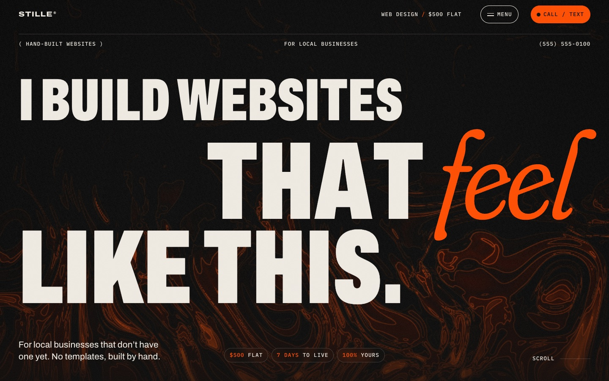

# STILLE

A fully animated one-page website I designed and built to pitch my web design work to local businesses: proof that a small business site can feel like a high-end product launch.

**Live site → [stillebuilds.netlify.app](https://stillebuilds.netlify.app)**



## What's in it

- **Hi-vis look:** black, bone and safety orange, with poster-sized condensed type that is fitted to the exact width of the screen at every size.
- **A thermal-map hero shader** (plain WebGL2): molten heat pools along the bottom edge, thin contour lines ride the isotherms, and your cursor is a heat source.
- **A real 3D phone** (three.js): it spins in from the back, then the screen scrolls through a live local-business site while each feature is explained beside it.
- **Scroll-told story** built on GSAP ScrollTrigger and Lenis smooth scrolling: the hero sinks back as the next section slides over it, marquee tapes speed up with scroll velocity, process cards stack, and recent builds slide past sideways.
- **Small details:** a counter loader, a magnetic call button, a spinning sticker badge, a custom cursor, and a footer wordmark whose letters lift toward your pointer.
- **Accessibility:** respects `prefers-reduced-motion` (no pins, no scrubbing, everything readable as a plain page), has a keyboard-navigable section menu, and keeps text contrast readable in every section.

## Built with

Vite · three.js · GSAP + ScrollTrigger + SplitText · Lenis · plain JavaScript and CSS, no framework. The JavaScript needed for first paint is about 61 kB gzipped; three.js for the phone (about 145 kB) streams in afterwards.

## Run it

```bash
npm install
npm run dev      # http://localhost:5173
npm run build    # production build in dist/
```

The contact number is injected at build time from `.env`, which ships with a fictional 555 placeholder. A real number goes in `.env.local`, which is gitignored.

## How I built it

I built this with AI coding agents, mainly [Claude Code](https://claude.com/claude-code). I set the creative direction and design references, made the call on every section, and tested each change by hand in real browsers, reporting what looked or felt off. The AI wrote most of the code. Commits are co-authored, so the history shows how it came together.
